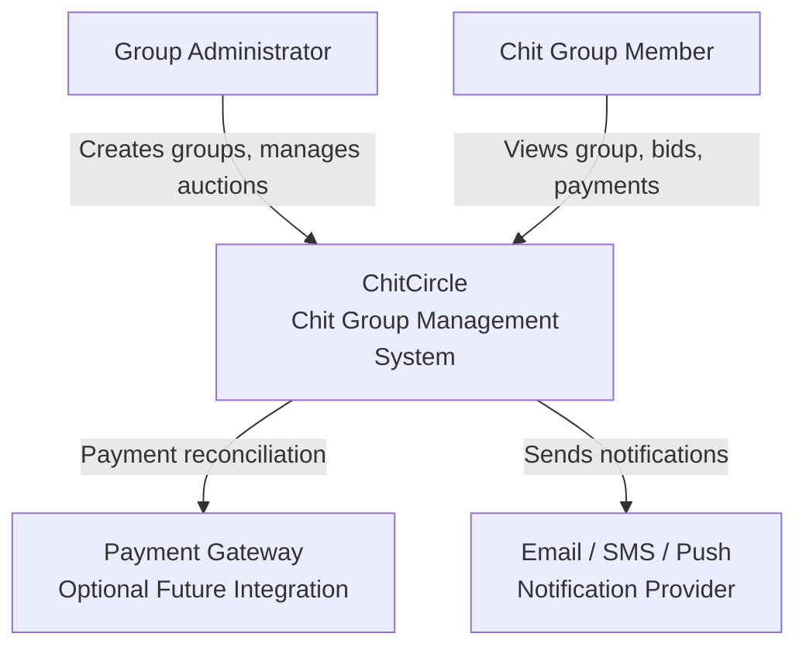

# C4 Level 1 — System Context Diagram

The System Context diagram illustrates ChitCircle within its environment, highlighting actors (Administrators and Chit Members) and external integrations.

## Actors & External Systems

### 1. Group Administrator
- Creates and configures chit groups.
- Enrolls members (up to 20 per circle).
- Schedules and conducts monthly auctions.
- Validates bids, declares auction winners, and settles prize payouts.
- Reconciles member contributions and dues.

### 2. Chit Group Member
- Views chit circle status and tenure progress.
- Tracks monthly contributions and dividend offsets.
- Submits discount bids during live auctions.
- Views real-time leaderboard and winner declarations.
- Accesses individual immutable ledger statement.

### 3. External Integrations
- **Payment Reconciliation / Gateway**: Reconciles UPI, NEFT, IMPS reference numbers.
- **Notification Service**: Triggers alerts for scheduled auctions, winner announcements, and dues reminders.

