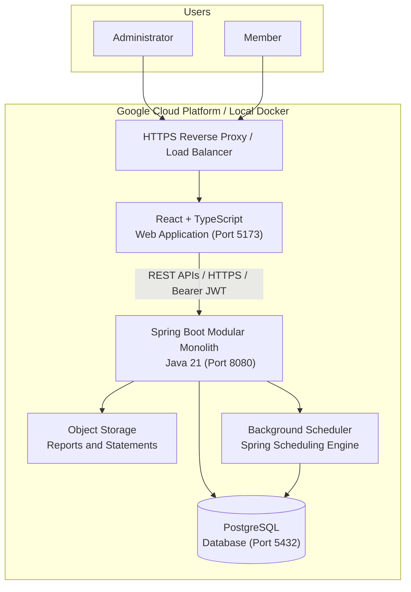

# C4 Level 2 — Container Architecture

The Container diagram depicts the high-level technical architecture of ChitCircle, consisting of the React SPA client, Spring Boot Modular Monolith, PostgreSQL persistence layer, and cloud hosting infrastructure.

## Container Responsibilities

| Container | Technology | Responsibilities |
|---|---|---|
| Frontend | React 18/19, TypeScript, TailwindCSS, Vite | Single-page UI, responsive dashboard, real-time bidding console, member dues tracker, and ledger visualizer. |
| Backend | Java 21, Spring Boot 3.4, Spring Security, Hibernate | Modular monolith enforcing business logic, auction state machines, atomic settlement transactions, and immutable ledger logging. |
| Database | PostgreSQL 16 / H2 (dev/test) | Relational persistence, unique constraints, foreign keys, and indexes for audit logs, payments, and auctions. |
| Background Worker | Spring `@EnableScheduling` | Automatic status checks, payment reminder dispatch, and statement export compilation. |

