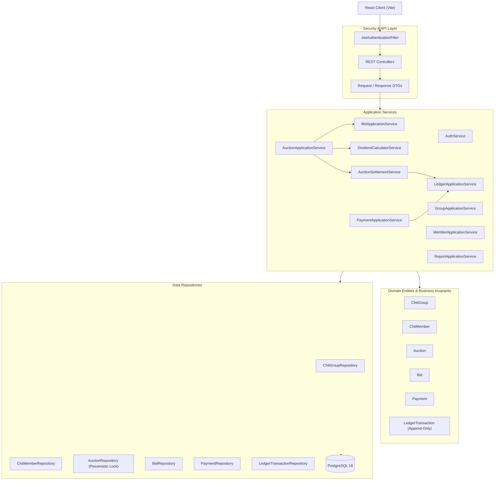

# C4 Level 3 — Backend Component Architecture

The Component diagram breaks down the Spring Boot Modular Monolith into discrete business domain modules.

## Module Responsibilities

1. **Identity & Security**: User authentication, JWT issuance, BCrypt password hashing, and role verification (`ROLE_SUPER_ADMIN`, `ROLE_GROUP_ADMIN`, `ROLE_GROUP_MEMBER`).
2. **Chit Group Management**: Group lifecycle (`DRAFT`, `ACTIVE`, `COMPLETED`), pool configuration, and 20-member constraints.
3. **Auction Management & Bidding**: Enforces minimum (5%) and statutory maximum (40%) discount rates, prevents duplicate bids, enforces the rule that previous winners cannot bid, and breaks ties via earliest timestamp.
4. **Dividend Calculator**: Strict `BigDecimal` arithmetic dividing winning discounts equally across members and calculating winner net payout.
5. **Financial Ledger**: Invariant append-only audit trail logging every credit, debit, dividend distribution, and prize payout.

