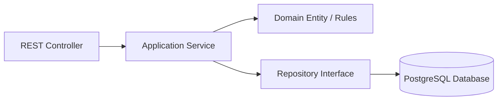

# C4 Level 4 — Code Architecture

Within each domain module, code follows clean layered architecture:

### Invariant Rules
1. **Controllers**: Pure entry points with Bean Validation (`@Valid`). Controllers never execute business rules or financial math.
2. **Services**: Encapsulate business logic, orchestrate entity persistence, and handle transactional boundaries (`@Transactional`).
3. **Domain Layer**: Enforces state machine transitions (`CREATED -> OPEN -> CLOSED -> WINNER_DECLARED -> SETTLED`).
4. **Pessimistic Locking**: `AuctionSettlementService` locks the auction row (`findByIdForUpdate`) to guarantee that prize disbursement and ledger entries cannot be duplicated or executed concurrently.
5. **No Double / Float**: All financial figures use Java `BigDecimal` with 2 decimal places and `HALF_UP` rounding.

